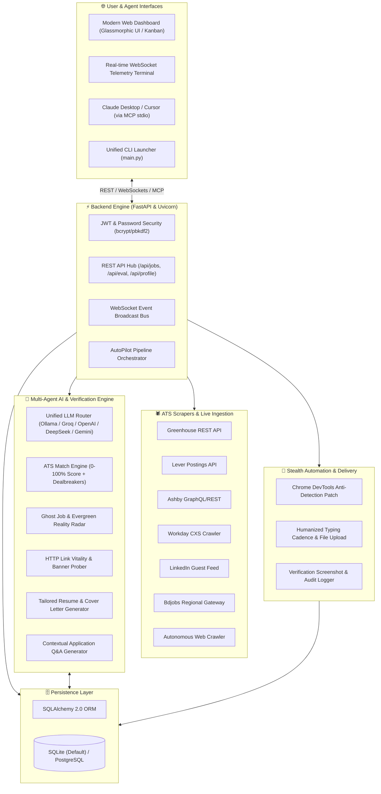
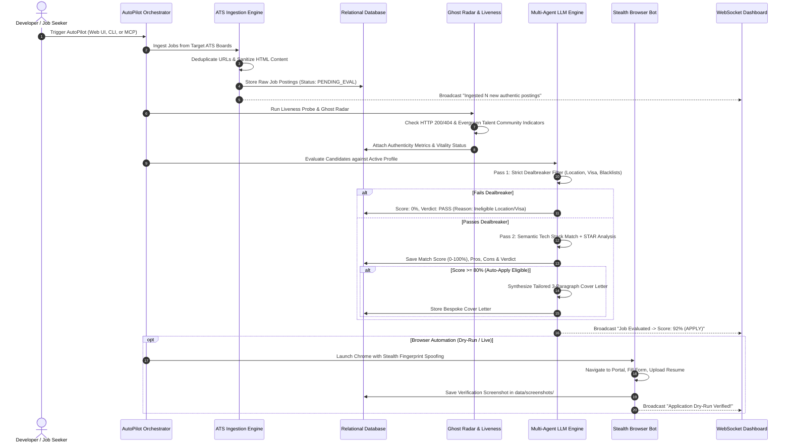

# ⚡ AI Job Hunter: Autonomous Multi-Agent Career & Job Application Platform

[](https://github.com/JamilKhanEmon/AIJobHunter/stargazers)
[](https://github.com/JamilKhanEmon/AIJobHunter/network/members)
[](https://python.org)
[](https://fastapi.tiangolo.com)
[](https://www.sqlalchemy.org)
[](https://modelcontextprotocol.io)
[](LICENSE)

> **The next-generation open-source AI platform that discovers, evaluates, and applies to authentic tech jobs directly from employer Applicant Tracking Systems (Greenhouse, Lever, Ashby, Workday, LinkedIn, Bdjobs). Features local & cloud multi-agent LLM reasoning, STAR behavioral alignment, an anti-evergreen Ghost Job Radar, real-time HTTP link vitality probing, bespoke cover letter synthesis, and an official Model Context Protocol (MCP) server for Claude Desktop & Cursor.**

---

## 📑 Table of Contents

- [🌟 Key Highlights & Differentiators](#-key-highlights--differentiators)
- [🎯 The Problem vs. The AI Job Hunter Solution](#-the-problem-vs-the-ai-job-hunter-solution)
- [🏛️ System Architecture](#️-system-architecture)
- [🔄 End-to-End Autonomous Workflow](#-end-to-end-autonomous-workflow)
- [🧩 Deep-Dive: Core Subsystems & Components](#-deep-dive-core-subsystems--components)
  - [1. Direct ATS Ingestion & Autonomous Web Discovery](#1-direct-ats-ingestion--autonomous-web-discovery)
  - [2. Ghost Job & Evergreen Reality Radar](#2-ghost-job--evergreen-reality-radar)
  - [3. Real-Time Link Vitality & Liveness Verifier](#3-real-time-link-vitality--liveness-verifier)
  - [4. Multi-Agent AI & LLM Routing Engine](#4-multi-agent-ai--llm-routing-engine)
  - [5. Candidate Profile & Smart Resume Parser](#5-candidate-profile--smart-resume-parser)
  - [6. Anti-Bot Browser Automation & Dry-Run Submitter](#6-anti-bot-browser-automation--dry-run-submitter)
  - [7. Glassmorphic Web Radar & Dashboard](#7-glassmorphic-web-radar--dashboard)
  - [8. Relational Multi-User Persistence Layer](#8-relational-multi-user-persistence-layer)
- [🤖 Model Context Protocol (MCP) Server](#-model-context-protocol-mcp-server)
  - [Available MCP Tools](#available-mcp-tools)
  - [Setup with Claude Desktop & Cursor](#setup-with-claude-desktop--cursor)
- [📂 Comprehensive Project Directory Structure](#-comprehensive-project-directory-structure)
- [⚙️ Step-by-Step Installation & Setup (A to Z)](#️-step-by-step-installation--setup-a-to-z)
  - [Prerequisites](#prerequisites)
  - [Installation Steps](#installation-steps)
  - [Configuration (`config.yaml`, `secrets.yaml`, `profile_resume.yaml`)](#configuration)
- [🖥️ CLI & Operations Reference](#️-cli--operations-reference)
- [🧠 Supported LLM Providers & Inference Options](#-supported-llm-providers--inference-options)
- [🐳 Docker & Containerized Deployment](#-docker--containerized-deployment)
- [🔒 Security, Data Privacy & Anti-Spam Ethics](#-security-data-privacy--anti-spam-ethics)
- [🤝 Contributing & Community](#-contributing--community)
- [📄 License](#-license)

---

## 🌟 Key Highlights & Differentiators

| Capability | What It Does | Why It Matters |
| :--- | :--- | :--- |
| **Direct ATS Crawlers** | Ingests from Greenhouse, Lever, Ashby, Workday, LinkedIn & Bdjobs without brittle HTML scrapers | Zero DOM breakages; catches fresh postings within minutes of publishing |
| **Ghost Job Radar** | Analyzes posting text, perpetual hiring indicators, repost age, and stale keywords | Saves applicants from wasting hours on fake listings or perpetual talent pools |
| **Link Vitality Prober** | Probes employer HTTP response codes, redirects, and closed job banners | Automatically flags expired requisitions and dead 404 links |
| **Deterministic Dealbreaker Check** | Filters visa requirements, relocation rules, remote eligibility, and blacklist titles | Rejects 100% of non-viable jobs before consuming any LLM compute |
| **STAR Framework Scoring** | Mathematical 0–100% ATS score using Situation, Task, Action, Result matching | Provides objective, actionable reasons for match fit |
| **Bespoke Cover Letter Studio** | Generates authentic 3-paragraph tailored cover letters mapped to candidate projects | High-conversion outreach without sounding like generic AI spam |
| **Safe Dry-Run Submitter** | Fills forms with human typing cadence and stops right before the submit button | Captures full-page screenshots to inspect entries before live submission |
| **Official MCP Server** | Exposes 11 native MCP tools over standard I/O (stdio) | Converse directly with your job pipeline inside Claude Desktop, Cursor, or Antigravity |
| **100% Private & Local Inference** | Runs completely offline with Ollama (Llama 3.3, DeepSeek-R1, Mistral) or ultra-fast Groq LPU | Candidate resume and personal details never leave your machine |

---

## 🎯 The Problem vs. The AI Job Hunter Solution

```
┌─────────────────────────────────────────────────┐   ┌─────────────────────────────────────────────────┐
│        TRADITIONAL JOB HUNTING PROBLEMS         │   │            AI JOB HUNTER SOLUTION               │
├─────────────────────────────────────────────────┤   ├─────────────────────────────────────────────────┤
│ ❌ 75%+ applications blocked by ATS black-box   │──▶│ ✅ 0-100% ATS STAR scoring highlights exact fit │
│ ❌ 30% postings are "Ghost Jobs" / Evergreen    │──▶│ ✅ Built-in Ghost Radar flags perpetual pools   │
│ ❌ Applying to dead/expired requisition links   │──▶│ ✅ HTTP Liveness Prober verifies active careers │
│ ❌ Generic resumes fail keyword filters         │──▶│ ✅ Bespoke Cover Letters & Tailored Highlights  │
│ ❌ Headless spam bots cause IP & recruiter bans │──▶│ ✅ Anti-Bot Stealth Chrome & Safe Dry-Run Mode  │
│ ❌ Scattered spreadsheets and lost follow-ups   │──▶│ ✅ Integrated Kanban & Real-time WebSockets UI  │
└─────────────────────────────────────────────────┘   └─────────────────────────────────────────────────┘
```

---

## 🏛️ System Architecture

AI Job Hunter is engineered as a modular, loosely coupled multi-tier architecture powered by **FastAPI**, **SQLAlchemy ORM**, **Multi-Agent LLM Orchestrators**, **Stealth Chrome CDP Drivers**, and a **Reactive Glassmorphic Web Dashboard**:



---

## 🔄 End-to-End Autonomous Workflow

When the system runs on **AutoPilot**, it executes an autonomous 7-step pipeline:



---

## 🧩 Deep-Dive: Core Subsystems & Components

### 1. Direct ATS Ingestion & Autonomous Web Discovery
Rather than relying on fragile HTML parsing that breaks whenever a website updates its layout, **AI Job Hunter** directly queries the structured endpoints exposed by top Applicant Tracking Systems:

* **Greenhouse (`scrapers/greenhouse_crawler.py`)**: Interacts with `https://boards-api.greenhouse.io/v1/boards/{token}/jobs?content=true`. Downloads structured JSON with company departments, office locations, salary bands, and clean descriptions.
* **Lever (`scrapers/lever_crawler.py`)**: Communicates with `https://api.lever.co/v0/postings/{company}?mode=json`. Parses workplace types (`Remote`, `Hybrid`, `Onsite`) and commitment formats.
* **Ashby HQ (`scrapers/ashby_crawler.py`)**: Interacts with the modern public API used by top AI & tech unicorns (OpenAI, Cursor, Retool, Ramp, Mistral).
* **Workday CXS (`scrapers/workday_crawler.py`)**: Queries candidate experience services (CXS) search endpoints with pagination.
* **LinkedIn Public Search (`scrapers/linkedin_scraper.py`)**: Fetches postings via LinkedIn guest feeds (`f_TPR=r86400`) within the last 24 hours **without requiring user credentials** or triggering account security challenges.
* **Bdjobs Scraper (`scrapers/bdjobs_scraper.py`)**: Gateway crawler for regional engineering and tech roles in Bangladesh.
* **ATS URL Auto-Detector (`scrapers/ats_detector.py`)**: Accepts any career URL, inspects HTTP redirects, CNAME records, and DOM signatures to route the job to the correct ATS crawler automatically.
* **Autonomous Discovery (`scrapers/autonomous_discovery.py`)**: Scans known tech ecosystems for fresh openings matching candidate preferences without manual token input.

---

### 2. Ghost Job & Evergreen Reality Radar
An estimated 20–30% of tech job listings are "Ghost Jobs"—openings kept posted perpetually to collect resumes or project fake growth without an active hiring requisition.

The **Ghost Radar (`scrapers/ghost_detector.py`)** runs heuristic scoring against multiple risk vectors:
1. **Perpetual Talent Pool Indicators**: Flags keywords like *"talent community"*, *"future opportunities"*, *"evergreen"*, *"general application"*, *"always looking for great talent"*.
2. **Posting Age & Staleness**: Penalizes postings older than 30–60 days that remain unfilled in fast-paced software sectors.
3. **Vague Requisition Signatures**: Analyzes absence of concrete team names, specific project milestones, or specific deliverables.
4. **Authenticity Score (0–100%)**: Visualized in the web dashboard with traffic-light badges (`High Authenticity`, `Moderate`, `Likely Ghost Job`).

---

### 3. Real-Time Link Vitality & Liveness Verifier
Job links go stale rapidly when applications close. The **Liveness Verifier (`scrapers/liveness_verifier.py`)** executes non-blocking HTTP probes:
* Detects HTTP status codes (`200 OK`, `404 Not Found`, `410 Gone`, `301/302 Redirect`).
* Scans response text for closure banners (*"This position has been filled"*, *"No longer accepting applications"*, *"Requisition closed"*).
* Prevents applicants from spending time reading or preparing documents for obsolete vacancies.

---

### 4. Multi-Agent AI & LLM Routing Engine
Located in `ai_engine/`, this subsystem powers all cognitive reasoning:

* **Unified LLM Router (`llm_router.py`)**: Seamless abstraction layer supporting:
  - **Local Ollama** (Llama 3.3, DeepSeek-R1, Mistral, Qwen 2.5) — 100% private, zero cost.
  - **Groq Cloud LPU** (`llama-3.3-70b-versatile`, `mixtral-8x7b`) — Sub-second inference, free tier.
  - **OpenAI Commercial API** (`gpt-4o-mini`, `gpt-4o`, `o3-mini`).
  - **DeepSeek API** (`deepseek-chat`, `deepseek-reasoner`).
  - **Anthropic Claude API** (`claude-3-5-sonnet`, `claude-3-5-haiku`).
  - **Google Gemini API** (`gemini-2.0-flash`, `gemini-1.5-pro`).
  - **OpenRouter Gateway** (200+ models).
* **ATS Fit Evaluator (`ats_evaluator.py`)**:
  - **Pass 1 (Dealbreakers)**: Evaluates visa sponsorship, relocation assistance, citizenship constraints, and blacklisted titles (`Intern`, `Unpaid`, `Volunteer`).
  - **Pass 2 (STAR Alignment)**: Maps candidate bullet points to required competencies and scores fit from 0 to 100%.
* **Cover Letter Studio & Resume Tailorer (`resume_tailorer.py`)**: Synthesizes bespoke cover letters adopting chosen personas (Technical, Executive, Creative, Concise).
* **Form Answer Agent (`form_answer_agent.py`)**: Answers arbitrary recruiter screening questions dynamically from candidate profile facts.

---

### 5. Candidate Profile & Smart Resume Parser
* **Resume Parser (`ai_engine/resume_parser.py`)**: Parses PDF and raw text resumes using NLP regex and LLM entity extraction to populate structured candidate schemas.
* **Profile YAML Schema (`config/profile_resume.yaml`)**: Stores personal details, categorized skills (Languages, Frameworks, AI, DevOps), verified project metrics, education, and pre-answered screening questionnaires.

---

### 6. Anti-Bot Browser Automation & Dry-Run Submitter
Located in `automation/`:
* **Undetected Chrome Driver (`browser_manager.py`)**: Manages browser sessions with custom user data profiles to preserve cookies and session state.
* **Stealth CDP Hooks (`stealth_patch.py`)**: Removes `window.navigator.webdriver`, mimics real plugin arrays, emulates native screen resolutions, and injects realistic hardware concurrency values.
* **Humanized Form Filler (`form_filler.py`)**: Uses variable typing cadence (30ms–120ms per keystroke), smooth scrolling, and human-like field focus.
* **Safe Dry-Run Submitter**: Halts execution right before the final submission button, capturing a full-page verification screenshot in `data/screenshots/` for manual inspection.

---

### 7. Glassmorphic Web Radar & Dashboard
Located in `frontend/`:
* **Executive Dark & Light Mode**: High-contrast, accessibility-tested theme toggle.
* **Real-Time Telemetry Terminal**: WebSockets stream live crawler logs, ATS scores, and autopilot events directly into the browser.
* **Visual Kanban Pipeline**: Drag-and-drop tracking across `Discovered`, `Matched`, `Applied`, `Interviewing`, `Offer`, and `Rejected`.
* **Cover Letter Studio**: Real-time generation, editing, copying, and downloading of tailored application letters.
* **Dynamic AI Provider Selector**: One-click provider switching with live connection testing and model discovery.

---

### 8. Relational Multi-User Persistence Layer
Located in `database/`:
* **SQLAlchemy 2.0 ORM (`database/models.py`)**: High-performance relational mappings for `User`, `UserProfile`, `Job`, `JobEvaluation`, `ApplicationRecord`, and `AutomationLog`.
* **Flexible Storage**: SQLite (`data/job_hunter.db`) out-of-the-box for instant zero-dependency local runs, or PostgreSQL for high-concurrency production deployments.
* **Full Multi-User Isolation**: Supports secure multi-user JWT authentication with strictly separated profiles, search preferences, and API keys.

---

## 🤖 Model Context Protocol (MCP) Server

AI Job Hunter includes an official **Model Context Protocol (MCP)** server (`mcp_server.py`) that implements standard I/O (stdio) transport, allowing AI desktop applications like **Claude Desktop**, **Cursor**, or **Antigravity** to interface directly with your job hunting pipeline.

```
┌─────────────────────────┐          JSON-RPC over stdio          ┌─────────────────────────┐
│     Claude Desktop      │ ◄───────────────────────────────────► │      mcp_server.py      │
│      Cursor IDE         │                                       │     (JobHunter MCP)     │
└─────────────────────────┘                                       └────────────┬────────────┘
                                                                               │ Calls
                                                                  ┌────────────▼────────────┐
                                                                  │ AI Job Hunter Backend   │
                                                                  │ (Jobs, ATS, Cover Docs) │
                                                                  └─────────────────────────┘
```

### Available MCP Tools

| Tool Name | Scope | Capability |
| :--- | :--- | :--- |
| `get_my_profile` | Profile | Returns candidate headline, skills, experience, and mobility parameters |
| `set_my_resume_text` | Profile | Dynamically parses raw CV text into active candidate model |
| `reset_to_default_profile` | Profile | Resets candidate profile to system defaults |
| `search_live_jobs` | Search | Ingests real-time jobs from Greenhouse, Lever, Ashby, Workday, or LinkedIn |
| `autonomous_web_discovery`| Discovery | Scans public ATS domains for keyword opportunities |
| `match_jobs_with_my_cv` | Scoring | Calculates STAR-aligned 0-100% match scores |
| `deep_evaluate_job` | Reasoning | Generates pros, cons, recommendations, and executive summaries |
| `verify_job_authenticity` | Trust | Probes HTTP header liveness and Ghost Job heuristics |
| `generate_tailored_cover_letter` | Apply | Generates high-conversion 3-paragraph bespoke cover letters |
| `update_application_stage` | Pipeline | Advances application tracking status (`APPLIED`, `INTERVIEWING`, etc.) |
| `get_application_pipeline` | Pipeline | Returns full overview of pipeline metrics |

### Setup with Claude Desktop & Cursor

Add the following snippet to your Claude Desktop configuration file:
* **macOS**: `~/Library/Application Support/Claude/claude_desktop_config.json`
* **Windows**: `%APPDATA%\Claude\claude_desktop_config.json`

```json
{
  "mcpServers": {
    "jobhunter-ai": {
      "command": "python3",
      "args": [
        "/path/to/AIJobHunter/mcp_server.py"
      ],
      "env": {
        "PYTHONPATH": "/path/to/AIJobHunter"
      }
    }
  }
}
```

Once configured, simply ask Claude in natural language:
> *"Show me remote Python openings at Stripe with an 80%+ ATS match score and synthesize a tailored cover letter for the best match."*

---

## 📂 Comprehensive Project Directory Structure

```text
AIJobHunter/
│
├── frontend/                          # Glassmorphic Web Dashboard
│   ├── index.html                     # Live radar, analytics, mission control & logs UI
│   ├── css/
│   │   └── style.css                  # Modern responsive design system, animations & themes
│   └── js/
│       └── app.js                     # Reactive frontend controller & WebSocket telemetry client
│
├── backend/                           # FastAPI Backend Services
│   ├── __init__.py
│   ├── app.py                         # Application entry point, CORS, static routes
│   ├── auth.py                        # JWT authentication & password hashing (bcrypt/pbkdf2)
│   ├── websocket.py                   # WebSocket connection manager & broadcast bus
│   ├── routes/                        # Modular REST API endpoints
│   │   ├── applications.py            # Application tracking, liveness probing & ghost radar
│   │   ├── auth.py                    # User registration, login & profile resolution
│   │   ├── crawlers.py                # Crawler trigger, target lists & discovery endpoints
│   │   ├── evaluation.py              # LLM evaluation batch runners & cover letter studio
│   │   ├── jobs.py                    # Job queries, filtering, search, and manual mutations
│   │   ├── mcp.py                     # MCP server status & configuration inspection
│   │   ├── pipeline.py                # AutoPilot triggers, instant runs, pruning & resets
│   │   ├── profile.py                 # Candidate profile editor, AI settings & model discovery
│   │   └── stats.py                   # System-wide metrics & dashboard analytics
│   └── services/
│       └── autopilot.py               # Unified end-to-end AutoPilot runner
│
├── ai_engine/                         # Multi-Agent Intelligence Layer
│   ├── __init__.py
│   ├── ats_evaluator.py               # ATS match scoring (0-100%), dealbreaker filter
│   ├── cv_matcher.py                  # Semantic technical keyword match engine
│   ├── form_answer_agent.py           # Multi-step screening question answer generator
│   ├── llm_router.py                  # Unified client (Ollama, Groq, DeepSeek, OpenAI, etc.)
│   ├── prompts.py                     # Optimized system prompts & evaluation templates
│   ├── resume_parser.py               # PDF and raw text resume extractor
│   └── resume_tailorer.py             # Tailored cover letter & bullet generator
│
├── scrapers/                          # Direct ATS Crawlers & Verification
│   ├── __init__.py
│   ├── ashby_crawler.py               # Ashby HQ API crawler (OpenAI, Cursor, etc.)
│   ├── ats_detector.py                # Automatic ATS engine detector for arbitrary URLs
│   ├── autonomous_discovery.py        # Automated keyword discovery across company boards
│   ├── base_scraper.py                # Abstract base class & normalized data models
│   ├── bdjobs_scraper.py              # Gateway crawler for Bdjobs.com listings
│   ├── ghost_detector.py              # Ghost job & evergreen talent pool heuristics
│   ├── greenhouse_crawler.py          # Greenhouse JSON API crawler (Stripe, Figma, etc.)
│   ├── lever_crawler.py               # Lever Postings API crawler (Spotify, Netflix, etc.)
│   ├── linkedin_scraper.py            # LinkedIn guest search extractor (no credentials needed)
│   ├── liveness_verifier.py           # Real-time HTTP link vitality prober
│   └── workday_crawler.py             # Workday CXS crawler
│
├── automation/                        # Anti-Bot Browser Automation
│   ├── __init__.py
│   ├── application_logger.py          # Execution trace recorder & screenshot saver
│   ├── browser_manager.py             # Undetected Chrome WebDriver manager
│   ├── form_filler.py                 # Humanized typing cadence and element interactor
│   ├── linkedin_easy_applier.py       # Multi-step LinkedIn modal applier
│   ├── stealth_patch.py               # CDP anti-detection hooks & fingerprint evasion
│   └── universal_ats_applier.py       # Universal multi-ATS form filler
│
├── database/                          # Persistence & ORM
│   ├── __init__.py
│   ├── connection.py                  # SQLAlchemy engine & session maker (SQLite / Postgres)
│   ├── models.py                      # Relational models (Job, Evaluation, User, Profile)
│   └── repository.py                  # CRUD repository operations
│
├── config/                            # Configuration & Candidate Profile
│   ├── config.yaml                    # System parameters, search terms, and crawler targets
│   ├── logger.py                      # Centralized logging formatters
│   ├── profile_resume.yaml            # Active candidate experience, skills & Q&A (GitIgnored)
│   ├── profile_resume.yaml.example    # Example candidate profile template
│   ├── secrets.yaml                   # Private API keys & credentials (GitIgnored)
│   ├── secrets.yaml.example           # Example API keys configuration template
│   └── settings.py                    # Dynamic Pydantic configuration loader
│
├── scripts/                           # Standalone CLI Utilities
│   ├── run_apply.py                   # Standalone browser automation executor
│   ├── run_crawler.py                 # Standalone crawler CLI
│   ├── run_evaluation.py              # Standalone batch evaluation CLI
│   └── seed_demo_data.py              # Seeds database with realistic sample tech jobs
│
├── data/                              # Local Runtime Storage (GitIgnored)
│   ├── .gitkeep                       # Preserves directory in git
│   ├── job_hunter.db                  # Local SQLite database (Auto-created)
│   ├── screenshots/                   # Verification screenshots from dry-run applications
│   └── chrome_profile/                # Persistent browser session profile
│
├── docker/                            # Container assets
│   └── Dockerfile.backend             # Production container definition
├── docker-compose.yml                 # Multi-container orchestration (App + PostgreSQL + Ollama)
├── claude_desktop_config.json         # Reference configuration for Claude Desktop
├── main.py                            # Unified CLI & server launcher
├── mcp_server.py                      # Official Model Context Protocol stdio server
├── requirements.txt                   # Production Python dependencies
└── .gitignore                         # Strict credential and database exclusion rules
```

---

## ⚙️ Step-by-Step Installation & Setup (A to Z)

### Prerequisites
* **Python**: Version 3.10, 3.11, or 3.12 installed.
* **Git**: Installed and configured.
* **Google Chrome**: Latest stable Chrome browser installed (for automation dry-runs).
* **LLM Provider (Choose one)**:
  - *Option A (Free & Local)*: [Ollama](https://ollama.ai) (`ollama run llama3.3` or `ollama run deepseek-r1:8b`).
  - *Option B (Free & Ultra-Fast Cloud)*: Free API Key from [Groq Console](https://console.groq.com).
  - *Option C (Commercial Cloud)*: OpenAI, DeepSeek, Anthropic, or Google Gemini API key.

---

### Installation Steps

#### 1. Clone the Repository
```bash
git clone https://github.com/JamilKhanEmon/AIJobHunter.git
cd AIJobHunter
```

#### 2. Create and Activate a Virtual Environment
```bash
# macOS / Linux
python3 -m venv venv
source venv/bin/activate

# Windows (PowerShell)
python -m venv venv
.\venv\Scripts\Activate.ps1
```

#### 3. Install Python Dependencies
```bash
pip install --upgrade pip
pip install -r requirements.txt
```

#### 4. Configure Your Settings & Profile
Create your local configuration files from the templates:
```bash
cp config/secrets.yaml.example config/secrets.yaml
cp config/profile_resume.yaml.example config/profile_resume.yaml
```

* **`config/secrets.yaml`**: Add your AI provider API key (e.g. Groq, OpenAI, Gemini) or leave blank if using local Ollama.
* **`config/profile_resume.yaml`**: Fill in your personal details, tech stack, past achievements, and screening question answers.
* **`config/config.yaml`**: Adjust target positions (e.g., `Full Stack Engineer`, `AI Engineer`), locations, and ATS target company boards.

---

## 🖥️ CLI & Operations Reference

The project includes a unified CLI executable via `main.py`:

```bash
# 1. Start the Web Dashboard and API Server
python3 main.py server

# 2. Seed realistic tech demo jobs (Stripe, Anthropic, OpenAI, Figma, Spotify)
python3 main.py seed

# 3. Crawl target company job boards directly
python3 main.py crawl --source greenhouse --target stripe
python3 main.py crawl --source ashby --target openai
python3 main.py crawl --source lever --target spotify
python3 main.py crawl --source linkedin --target "AI Engineer"
python3 main.py crawl --source bdjobs --target "Python"

# 4. Run AI ATS Evaluations on pending jobs
python3 main.py evaluate

# 5. Execute Safe Dry-Run Application with Chrome Browser
python3 main.py apply --job-id 1 --dry-run
```

---

## 🧠 Supported LLM Providers & Inference Options

You can configure your active provider directly in `config/config.yaml` or toggle it live in the Web Dashboard Settings:

| Provider | Model Identifier | Typical Speed | Est. Cost | Data Privacy |
| :--- | :--- | :--- | :--- | :--- |
| **Groq Cloud (Recommended)** | `llama-3.3-70b-versatile` | ~500 tok/sec | Free Tier | Cloud API |
| **Local Ollama (Recommended)** | `llama3.3:latest` / `deepseek-r1:8b` | ~30 tok/sec | 100% Free | 100% On-Device (Zero Data Sent) |
| **DeepSeek API** | `deepseek-chat` / `deepseek-reasoner` | ~80 tok/sec | Ultra-Low | Cloud API |
| **OpenAI Commercial** | `gpt-4o-mini` / `gpt-4o` | ~100 tok/sec | Pay per token | Cloud API |
| **Google Gemini** | `gemini-2.0-flash` | ~120 tok/sec | Generous Free Tier | Cloud API |
| **Anthropic Claude** | `claude-3-5-sonnet` | ~80 tok/sec | Pay per token | Cloud API |
| **OpenRouter** | `openrouter/auto` | Variable | Variable | Multi-Provider Gateway |

---

## 🐳 Docker & Containerized Deployment

Run the complete platform (Backend API + Web Dashboard + PostgreSQL) with a single command:

```bash
# Build and start services in the background
docker compose up -d

# Inspect live application logs
docker compose logs -f app

# Stop all containers
docker compose down
```

The Web Dashboard will be accessible immediately at **`http://localhost:8000`**.

---

## 🔒 Security, Data Privacy & Anti-Spam Ethics

1. **Strict Credential Isolation**: `config/secrets.yaml`, `.env`, and local `.db` files are strictly enforced in `.gitignore` to prevent accidental credential leakage.
2. **Safe Dry-Run Submissions**: The browser automation engine operates in dry-run mode by default, halting before any final submission button and capturing a timestamped screenshot in `data/screenshots/` for human review.
3. **No Account Password Risk**: LinkedIn and ATS scraping operates on public candidate feeds without requiring or storing user login credentials.
4. **Anti-Spam Philosophy**: This platform is designed for **high-intent, tailored career discovery**, not low-quality mass spamming. Tailored cover letters and authentic portal submissions safeguard your candidate reputation.

---

## 🤝 Contributing & Community

Contributions are warmly welcomed! To contribute:

1. Fork the repository on GitHub: `https://github.com/JamilKhanEmon/AIJobHunter`
2. Create your feature branch: `git checkout -b feature/amazing-feature`
3. Commit your changes: `git commit -m "feat: add amazing new capability"`
4. Push to the branch: `git push origin feature/amazing-feature`
5. Open a Pull Request on GitHub.

---

## 📄 License

This project is licensed under the **MIT License** — see the [LICENSE](LICENSE) file for full details.

---

<p align="center">
  <b>AI Job Hunter</b> • Built with ❤️ for intelligent, transparent, and authentic career growth.
</p>
