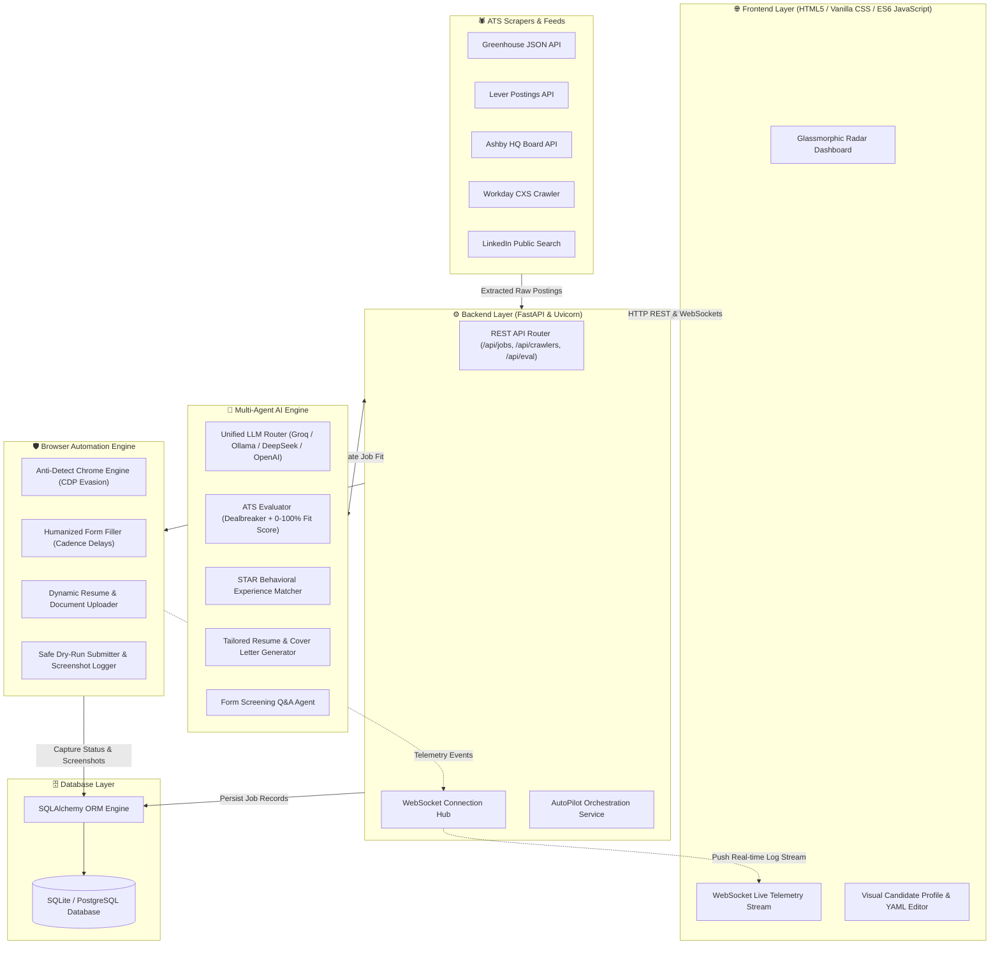
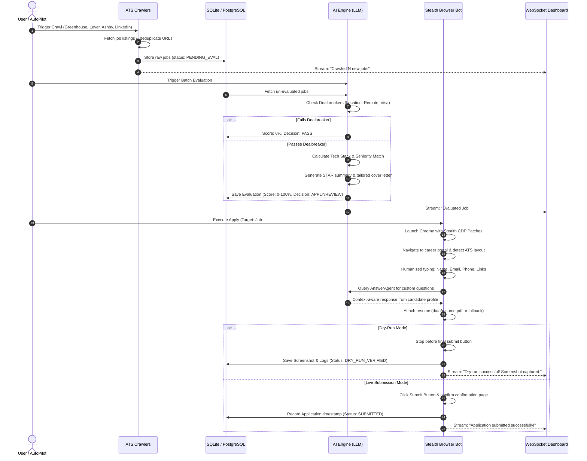
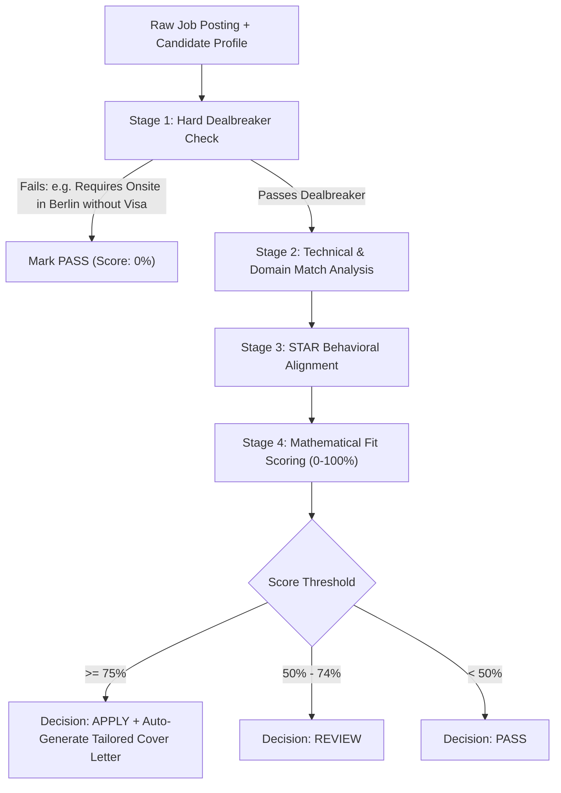
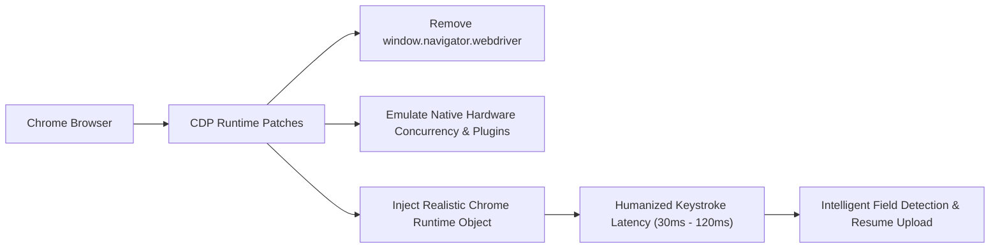
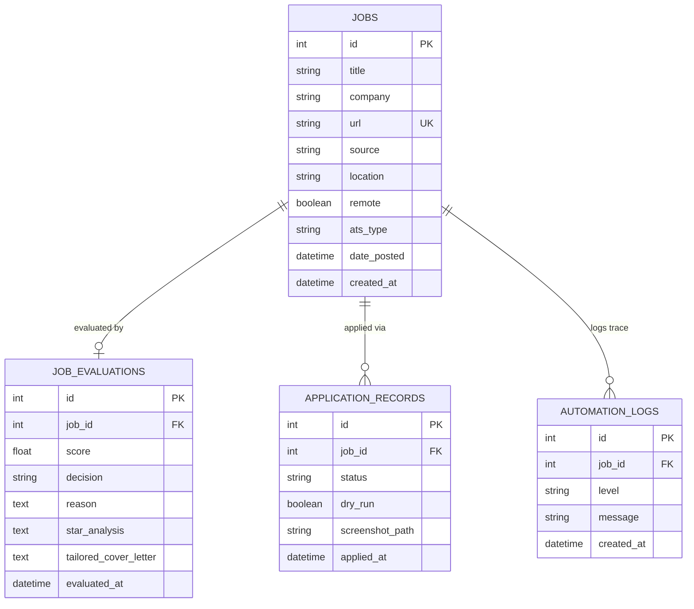

# ⚡ JobHunter AI - Autonomous Multi-Agent Career Platform

[](https://python.org)
[](https://fastapi.tiangolo.com)
[](https://www.sqlalchemy.org)
[](https://selenium.dev)
[](https://ollama.ai)
[](LICENSE)

**JobHunter AI** is an enterprise-grade, end-to-end autonomous career agent. It continuously monitors top tech company career boards (Greenhouse, Lever, Ashby, Workday, LinkedIn), parses and scores incoming postings against structured candidate background profiles using LLM reasoning (ATS Fit Scoring, STAR alignment, dealbreaker filtering), generates personalized cover letters, and auto-submits applications using anti-detection browser automation with real-time telemetry streaming to a glassmorphic dashboard.

---

## 🎯 Why This Project Was Built (The Problem & Solution)

### 🚨 The Problem in Modern Tech Job Hunting
1. **Fragmented Ecosystem**: Top tech companies do not post exclusively to generic boards. The freshest, most authentic openings exist directly on company-hosted ATS portals (Greenhouse, Lever, Ashby, Workday).
2. **Extreme Time Investment**: Completing a single application manually takes 15–30 minutes. Candidates spend dozens of hours repeatedly typing the same work history, education, and answers to repetitive screening questions.
3. **The ATS "Black Box" Barrier**: 75%+ of applicants are automatically rejected by ATS parsing algorithms before a human recruiter ever sees them. Generic resumes fail keyword and qualification alignment.
4. **Dealbreaker Traps**: Applicants frequently invest time applying to roles only to be auto-rejected hours later due to unadvertised location constraints, visa sponsorship policies, or required certifications.

### 💡 The JobHunter AI Solution
* **Zero-Click Live Job Ingestion**: Directly connects to ATS REST APIs and public candidate feeds to ingest live job postings within minutes of being published.
* **Pre-Screening Dealbreaker Engine**: Eliminates non-viable jobs immediately based on candidate visa requirements, citizenship, location policies, or experience thresholds.
* **Intelligent ATS Match Scoring (0–100%)**: Evaluates candidate fit using LLMs (Ollama, Groq, DeepSeek, OpenAI) using the STAR (Situation-Task-Action-Result) framework.
* **Tailored Document Generation**: Synthesizes custom cover letters and resume highlight bullets mapped directly to the specific job requirements.
* **Stealth Anti-Detect Browser Automation**: Emulates human interactions with dynamic typing cadence, fills complex multi-step forms, answers bespoke screening questions using candidate memory, uploads resumes, and captures verification screenshots in safe Dry-Run mode.

---

## 📑 Table of Contents

- [🏛️ System Architecture](#️-system-architecture)
- [🔄 End-to-End Workflow Diagram](#-end-to-end-workflow-diagram)
- [📂 Project Structure](#-project-structure)
- [🧩 Core Subsystems & Components](#-core-subsystems--components)
  - [1. Web Scrapers & ATS Discovery Engine](#1-web-scrapers--ats-discovery-engine)
  - [2. Multi-Agent AI & LLM Routing Engine](#2-multi-agent-ai--llm-routing-engine)
  - [3. Browser Automation & Anti-Bot Evasion Layer](#3-browser-automation--anti-bot-evasion-layer)
  - [4. Backend API & Real-time WebSockets](#4-backend-api--real-time-websockets)
  - [5. Glassmorphism Web Radar & Dashboard](#5-glassmorphism-web-radar--dashboard)
  - [6. Relational Persistence Layer](#6-relational-persistence-layer)
- [⚙️ Setup & Installation (A to Z)](#️-setup--installation-a-to-z)
- [🖥️ Usage & CLI Reference](#️-usage--cli-reference)
- [🧠 LLM Inference Options & Providers](#-llm-inference-options--providers)
- [🐳 Docker Deployment](#-docker-deployment)
- [🔒 Privacy, Security & Anti-Bot Safeguards](#-privacy-security--anti-bot-safeguards)

---

## 🏛️ System Architecture



---

## 🔄 End-to-End Workflow Diagram

The autonomous AutoPilot cycle operates as a deterministic multi-stage state machine:



---

## 📂 Project Structure

```text
job-hunter-ai/
│
├── frontend/                          # Glassmorphic Web Dashboard
│   ├── index.html                     # Live radar, analytics, mission control & logs UI
│   ├── css/style.css                  # Custom dark-theme design system and micro-animations
│   └── js/app.js                      # Reactive dashboard controller & WebSocket client
│
├── backend/                           # FastAPI Backend Services
│   ├── app.py                         # Application entry point, CORS, static routes
│   ├── websocket.py                   # WebSocket connection manager & broadcast bus
│   ├── routes/                        # REST API endpoints
│   │   ├── jobs.py                    # Job queries, filtering, and manual mutations
│   │   ├── crawlers.py                # Crawler trigger and status endpoints
│   │   ├── evaluation.py              # LLM evaluation batch runners
│   │   ├── automation.py              # Application bot executor and dry-run endpoints
│   │   └── settings.py                # Visual configuration & profile editor endpoints
│   └── services/
│       └── autopilot.py               # Unified end-to-end AutoPilot runner
│
├── ai_engine/                         # Multi-Agent Intelligence Layer
│   ├── llm_router.py                  # Unified client (Ollama, Groq, DeepSeek, OpenAI)
│   ├── ats_evaluator.py               # ATS match scoring (0-100%), dealbreaker filter
│   ├── form_answer_agent.py           # Multi-step screening question answer generator
│   ├── resume_tailorer.py             # Tailored cover letter & bullet generator
│   ├── resume_parser.py               # PDF and raw text resume extractor
│   └── prompts.py                     # Optimized system prompts & evaluation templates
│
├── scrapers/                          # Direct ATS Crawlers
│   ├── greenhouse_crawler.py          # Greenhouse JSON API crawler (Stripe, Figma, etc.)
│   ├── lever_crawler.py               # Lever Postings API crawler (Spotify, Netflix, etc.)
│   ├── ashby_crawler.py               # Ashby HQ API crawler (OpenAI, Cursor, etc.)
│   ├── workday_crawler.py             # Workday CXS crawler
│   ├── linkedin_scraper.py            # LinkedIn public search and job extractor
│   └── ats_detector.py                # Automatic ATS engine detector for URLs
│
├── automation/                        # Anti-Bot Browser Automation
│   ├── browser_manager.py             # Undetected Chrome WebDriver manager
│   ├── stealth_patch.py               # CDP anti-detection hooks & fingerprint evasion
│   ├── form_filler.py                 # Humanized typing cadence and element interactor
│   ├── universal_ats_applier.py       # Universal multi-ATS form filler
│   ├── linkedin_easy_applier.py       # Multi-step LinkedIn modal applier
│   └── application_logger.py          # Execution trace recorder & screenshot saver
│
├── database/                          # Persistence & ORM
│   ├── connection.py                  # SQLAlchemy engine & session maker
│   ├── models.py                      # Relational models (Job, JobEvaluation, Application)
│   └── repository.py                  # CRUD repository operations
│
├── config/                            # Configuration & Candidate Profile
│   ├── config.yaml                    # System parameters, search terms, and crawler targets
│   ├── secrets.yaml                   # API keys & credentials (GitIgnored)
│   ├── secrets.yaml.example           # Example configuration template
│   ├── profile_resume.yaml            # Candidate experience, skills, and pre-answered Q&A
│   ├── settings.py                    # Pydantic configuration loader
│   └── logger.py                      # Centralized logging formatters
│
├── scripts/                           # Standalone CLI Utilities
│   ├── seed_demo_data.py              # Seeds database with realistic sample tech jobs
│   ├── run_crawler.py                 # Standalone crawler CLI
│   ├── run_evaluation.py              # Standalone batch evaluation CLI
│   └── run_apply.py                   # Standalone browser automation executor
│
├── data/                              # Local Runtime Storage (GitIgnored)
│   ├── job_hunter.db                  # Local SQLite database
│   ├── screenshots/                   # Verification screenshots from browser runs
│   └── chrome_profile/                # Persistent browser session profile
│
├── docker/                            # Production container setup
├── docker-compose.yml                 # Multi-container orchestration (App + PostgreSQL)
├── main.py                            # Unified CLI & server launcher
└── requirements.txt                   # Production Python dependencies
```

---

## 🧩 Core Subsystems & Components

### 1. Web Scrapers & ATS Discovery Engine (How Jobs Are Found & Collected)

Instead of fragile DOM web scrapers that break whenever a website layout changes, **JobHunter AI** interfaces directly with the native RESTful endpoints and public candidate feeds exposed by modern Applicant Tracking Systems:

```mermaid
flowchart LR
    subgraph Targets ["🎯 Target Career Ecosystem"]
        T1["Greenhouse (boards-api.greenhouse.io)"]
        T2["Lever (api.lever.co/v0/postings)"]
        T3["Ashby (api.ashbyhq.com/posting-api)"]
        T4["Workday (wd1.myworkdayjobs.com/wday/cxs)"]
        T5["LinkedIn (jobs-guest/search?f_TPR=r86400)"]
    end

    subgraph Pipeline ["⚡ Ingestion & Sanitization Engine"]
        Crawler["Crawler Workers"]
        Detector["ATS URL Auto-Detector"]
        Dedupe["URL & Hash Deduplication"]
        HTMLStripper["HTML / Markdown Cleaner"]
        Norm["Schema Normalization"]
    end

    subgraph Store ["🗄️ Persistence"]
        DB[("Jobs Database (Pending Eval)")]
    end

    Targets --> Crawler
    Crawler --> Detector
    Detector --> Dedupe
    Dedupe --> HTMLStripper
    HTMLStripper --> Norm
    Norm --> DB
```



#### Detailed Ingestion Mechanics:
* **Greenhouse Crawler (`greenhouse_crawler.py`)**:
  - Connects to `https://boards-api.greenhouse.io/v1/boards/{board_token}/jobs?content=true`.
  - Downloads structured JSON containing full HTML descriptions, departments, office locations, and salary bands.
  - Strips boilerplate HTML tags and decodes character entities into clean, LLM-digestible markdown.
* **Lever Postings Crawler (`lever_crawler.py`)**:
  - Calls `https://api.lever.co/v0/postings/{company}?mode=json`.
  - Automatically identifies workplace type (`Remote`, `Hybrid`, `Onsite`) and employment commitment (`Full-time`, `Contract`).
* **Ashby HQ Crawler (`ashby_crawler.py`)**:
  - Interacts with Ashby's public job board GraphQL & REST interfaces used by high-growth AI companies (OpenAI, Cursor, Retool).
  - Normalizes multi-region compensation tiers and custom location taxonomies.
* **Workday CXS Crawler (`workday_crawler.py`)**:
  - Issues paginated POST requests against Workday's Candidate Experience Services (CXS) search endpoints.
  - Traverses large enterprise catalogs while avoiding session rate limits.
* **LinkedIn Public Scraper (`linkedin_scraper.py`)**:
  - Queries LinkedIn's guest job feed: `https://www.linkedin.com/jobs-guest/jobs/api/seeMoreJobPostings/search?keywords={keyword}&location={location}&f_TPR=r86400`.
  - **No authentication required**: Queries public guest feeds to eliminate account flagging risks.
  - Filters strictly for postings from the last 24 hours (`f_TPR=r86400`) to ensure first-mover advantage.
* **Universal ATS Auto-Detector (`ats_detector.py`)**:
  - Given any arbitrary career URL, it inspects response headers, CNAME redirects, script embeds, and DOM signatures to automatically route the URL to the optimal crawler engine.

---

### 2. Multi-Agent AI & LLM Routing Engine (How Fit is Evaluated)

Once jobs are collected, they pass through a strict multi-stage reasoning pipeline:



#### Evaluation Breakdown:
1. **Stage 1 - Dealbreaker Filter**:
   - Compares candidate location against job requirements.
   - Evaluates visa sponsorship requirements against `profile_resume.yaml`.
   - Prevents wasting compute or time on fundamentally ineligible roles.
2. **Stage 2 - Technical Fit Matrix**:
   - Computes semantic similarity between required skills (languages, frameworks, cloud platforms) and candidate skills.
   - Assesses seniority requirements (years of experience, engineering leadership expectations).
3. **Stage 3 - STAR Reasoning (Situation, Task, Action, Result)**:
   - Evaluates whether candidate bullet points demonstrate measurable impact relevant to the job's core challenges.
4. **Stage 4 - Tailored Document Synthesis**:
   - For jobs marked **APPLY**, the `ResumeTailorer` agent drafts a tailored, professional cover letter highlighting the exact 2-3 projects that best align with the company's tech stack.
5. **Stage 5 - Bespoke Form Answer Agent (`form_answer_agent.py`)**:
   - Parses open-ended application questions (e.g., *"What is your expected compensation?"*, *"Explain your experience with distributed consensus"*).
   - Generates contextual, consistent responses grounded in the candidate's structured profile.

### 3. Browser Automation & Anti-Bot Evasion Layer

Automating applications on modern web forms requires evading modern bot detection algorithms (Cloudflare Turnstile, DataDome, Akamai):



* **Safe Dry-Run Submitter**: By default, the bot navigates through all multi-step form pages, uploads the candidate resume, answers all questions, and halts immediately before clicking the final `Submit` button. It captures a full-page verification screenshot in `data/screenshots/` and logs the form state.

### 4. Relational Persistence Layer

The database schema is managed via SQLAlchemy ORM, supporting both SQLite for zero-setup local operation and PostgreSQL for multi-worker containerized deployments.



---

## ⚙️ Setup & Installation (A to Z)

### Prerequisites
- **Python**: Version 3.10, 3.11, or 3.12 installed.
- **Google Chrome**: Latest stable Chrome browser installed (for automation).
- **LLM Provider**: Either [Ollama](https://ollama.ai) running locally or a free [Groq Cloud](https://groq.com) API key.

### Step 1: Clone and Navigate to the Repository
```bash
git clone <your-repo-url>
cd job-hunter-ai
```

### Step 2: Create and Activate a Virtual Environment
```bash
python3 -m venv venv
source venv/bin/activate
```

### Step 3: Install Required Dependencies
```bash
pip install -r requirements.txt
```

### Step 4: Configure Secrets & Candidate Profile
1. Copy the example secrets file:
   ```bash
   cp config/secrets.yaml.example config/secrets.yaml
   ```
2. Edit `config/secrets.yaml` to specify your preferred AI provider:
   - For **Groq Cloud (Fast & Free)**: Add your `groq_api_key`.
   - For **Local Ollama**: Ensure Ollama is running (`ollama run llama3.3`) and set `ollama_host: "http://localhost:11434"`.
   - For **OpenAI / DeepSeek / Gemini**: Supply your respective API key.
3. Edit `config/profile_resume.yaml` with your background:
   - Full name, headline, email, phone number, location.
   - Core skills, tech stack, work experience bullets, education.
   - Screening answers (work authorization, notice period, salary targets).

---

## 🖥️ Usage & CLI Reference

### 1. Launch the Server & Web Dashboard
```bash
python3 main.py server
```
Navigate to **[http://localhost:8000](http://localhost:8000)** to view the live dashboard.

### 2. Seed Initial Tech Jobs (Demo Data)
```bash
python3 main.py seed
```

### 3. Run ATS Crawlers via CLI
```bash
# Crawl Greenhouse (e.g. Figma, Stripe, Anthropic)
python3 main.py crawl --source greenhouse --target figma

# Crawl Ashby (e.g. Cursor, Retool, OpenAI)
python3 main.py crawl --source ashby --target cursor

# Crawl Lever (e.g. Spotify, Netflix)
python3 main.py crawl --source lever --target spotify

# Crawl LinkedIn
python3 main.py crawl --source linkedin --target "AI Engineer"
```

### 4. Run AI Evaluation on Unscored Jobs
```bash
python3 main.py evaluate
```

### 5. Execute Browser Automation Bot (Safe Dry-Run Mode)
```bash
python3 main.py apply --job-id 1 --dry-run
```

---

## 🧠 LLM Inference Options & Providers

Select your active provider in `config/config.yaml` under `ai_router`:

| Provider | Model ID | Latency | Cost | Privacy |
| :--- | :--- | :--- | :--- | :--- |
| **Groq Cloud (Recommended)** | `llama-3.3-70b-versatile` | ~500 tok/sec | Free Tier | Cloud |
| **Ollama (Recommended)** | `llama3.3:latest` | ~25 tok/sec | Free / Local | 100% Private (On-Device) |
| **DeepSeek** | `deepseek-chat` | ~80 tok/sec | Low Cost | Cloud |
| **OpenAI** | `gpt-4o-mini` / `gpt-4o` | ~90 tok/sec | Pay per token | Cloud |
| **Offline Heuristic** | Built-in Rule Engine | Instant | $0 | 100% Offline (Zero API calls) |

---

## 🐳 Docker Deployment

To run the entire system in isolated containers with PostgreSQL:

```bash
# Build and launch services in background
docker compose up -d

# Check service logs
docker compose logs -f app

# Stop containers
docker compose down
```

---

## 🔒 Privacy, Security & Anti-Bot Safeguards

1. **Local Secrets Isolation**: `config/secrets.yaml` is excluded via `.gitignore` and never committed.
2. **Safe Dry-Run Verification**: The automation engine defaults to dry-run mode, stopping before any final submission button and capturing a full screenshot for human inspection.
3. **No Credential Logging**: All sensitive user credentials and tokens are masked in output logs and WebSocket streams.
4. **Humanized Rate Limiting**: Scrapers and automation workers introduce randomized jitter delays to conform to responsible web citizenship.

---

<p align="center">
  Built with ❤️ for autonomous career discovery and intelligent job matching.
</p>
